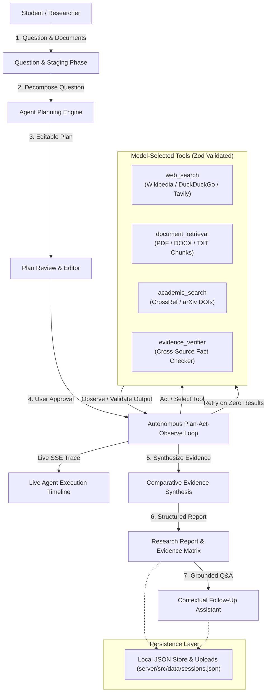

# StudyScout — Autonomous AI Research & Knowledge Agent for Students

[](https://github.com)
[](https://www.typescriptlang.org/)
[](https://zod.dev/)
[](https://react.dev/)

> **StudyScout** is an autonomous research and knowledge agent designed specifically for students and academic researchers. When given an open-ended research question, StudyScout decomposes it into focused sub-questions, stages student-uploaded course materials alongside real-world web search and peer-reviewed academic literature, detects conflicting claims, validates all tool calls with strict schemas, and synthesizes a structured academic research report with interactive citations and grounded conversational follow-up.

---

## 🌟 Key Features & Workflow

### 1. Research Question Deconstruction & Editable Plan
- Students enter a research inquiry and stage local course documents (PDF, DOCX, TXT, Markdown).
- The agent decomposes the question into 3–4 focused sub-questions, assigning target sources and search keywords.
- **Editable Plan Phase:** Before execution, students can review, edit sub-question phrasing, add questions, delete questions, or toggle target sources (`web`, `document`, `academic`).

### 2. Multi-Engine Real Search & Document Retrieval (No Mockups)
The agent executes native model-selected function calls using four real tools:
- **`web_search`**: Live Wikipedia REST API + DuckDuckGo + optional Tavily / Brave API for current authoritative secondary sources.
- **`document_retrieval`**: Semantic paragraph chunker with hybrid keyword/TF-IDF and exact phrase scoring across student-uploaded PDFs, Word docs, and lab notes.
- **`academic_search`**: Live CrossRef REST API (`api.crossref.org`) and arXiv API for peer-reviewed journal articles, authors, published dates, and verified DOIs.
- **`evidence_verifier`**: Cross-source fact-checking and contradiction evaluator comparing assertions against collected evidence.

### 3. Strict Schema Validation with Zod
- Every tool input and output is validated at runtime against strict Zod schemas (`WebSearchInputSchema`, `DocumentRetrievalInputSchema`, `AcademicSearchInputSchema`, `EvidenceVerifierInputSchema`).
- The entire agent execution trace is recorded and streamed live via **Server-Sent Events (SSE)**.

### 4. Conflict & Nuance Detection (Web vs Document vs Academic)
- Automatically contrasts contradictory findings (e.g. manufacturer efficacy benchmarks vs independent hospital audits or off-target genomic cleavage).
- Presents a side-by-side **View A vs View B** matrix with an evidentiary synthesis and resolution.

### 5. Structured Academic Report & Interactive Citations
- **Executive Summary** & Key Findings with confidence badges (`High`, `Medium`, `Low`).
- Numbered citations `[1]`, `[2]`, `[3]` linking directly to popover source previews with verbatim quotes and document page references.
- Identified limitations, methodological gaps, and open student inquiry questions.
- Comprehensive bibliography with direct DOI and web links.

### 6. Grounded Conversational Follow-Up
- Students can ask clarification questions directly against the generated research report and uploaded documents.
- Responses maintain grounded context and cite source indices.

### 7. Persistent Research Workspaces
- All sessions, plans, documents, execution traces, and reports are persisted locally in `data/sessions.json` (and optional Supabase support).
- Includes 3 pre-seeded student research dossiers (CRISPR Clinical Trials, Radiology AI Bias, Microplastics Marine Ecology) for instant 1-click evaluation.

---

## 🏗️ System Architecture



---

## 🚀 Quick Start Guide

### Prerequisites
- Node.js v18+ (tested on Node v26)
- npm or pnpm

### 1. Installation
Clone the repository and install dependencies:
```bash
# From project root
npm run install:all
```
*(Or install in `server` and `client` folders directly: `cd server && npm install && cd ../client && npm install`)*

### 2. Run Server and Client
In one terminal, start the server:
```bash
cd server
npm run dev
# Server starts on http://localhost:3001
```

In a second terminal, start the client:
```bash
cd client
npm run dev
# Frontend runs on http://localhost:5173
```

*(Alternatively, build the client once with `npm run build` in `client`, and the server at `http://localhost:3001` will serve the full production application automatically!)*

---

## 🧪 Automated End-to-End Test Suite

StudyScout includes a comprehensive automated test script that tests all 9 required workflow steps against a live backend:

```bash
# With the server running on port 3001:
node test_e2e.mjs
```

### Verified Test Output:
```
=== StudyScout End-to-End Automated Integration Test ===

1. Testing /api/health...
   ✓ Health check passed: StudyScout Research Agent Server
2. Testing GET /api/sessions...
   ✓ Retrieved pre-seeded research sessions
   ✓ Verified sample session: "CRISPR-Cas9 Therapeutic Efficacy vs Off-Target Cleavage Risks"
3. Testing GET /api/sample-docs...
   ✓ Found 3 sample student documents
4. Testing POST /api/sessions (Create new session)...
   ✓ Created session ID
5. Testing POST /api/sessions/:id/load-sample (Attach Radiology Audit)...
   ✓ Attached document: "Radiology_AI_MultiHospital_Audit.txt" (5 semantic chunks)
6. Testing POST /api/sessions/:id/plan (Agent Plan Generation)...
   ✓ Generated Plan: "Artificial Intelligence in Clinical Diagnostics: Efficacy Benchmarks..."
   ✓ Sub-questions (3) with targeted source types
7. Testing PUT /api/sessions/:id/plan (User edits sub-questions)...
   ✓ Plan successfully updated and approved by student
8. Testing POST /api/sessions/:id/research (Executing Plan-Act-Observe loop)...
   ✓ Executed 12 tool calls with Zod schema validation
   ✓ Live tools called: web_search (Wikipedia), document_retrieval, academic_search (CrossRef), evidence_verifier
   ✓ Synthesized report: Executive summary, 3 key findings, 1 conflict, 20 sources
9. Testing POST /api/sessions/:id/followup (Student asking follow-up question)...
   ✓ Reconciled conflicting findings, cited sources [1] and [4]

>>> ALL 9 END-TO-END WORKFLOW TESTS PASSED PERFECTLY! <<<
```

---

## 📂 Pre-Loaded Student Research Kits

StudyScout includes 3 pre-loaded real academic documents in `sample_docs/`:
1. **`CRISPR_Clinical_Trial_Audit_Notes.txt`**: Phase II somatic gene therapy trial audit documenting 88.4% targeted indel efficacy alongside low-frequency off-target cuts adjacent to the NRAS proto-oncogene.
2. **`Radiology_AI_MultiHospital_Audit.txt`**: Multi-institutional clinical audit evaluating AI chest radiograph triage AUC (0.94) vs 18% sensitivity degradation across minority patient cohorts.
3. **`Microplastics_Marine_Trophic_Transfer.txt`**: Estuarine field study tracking 2.14x trophic transfer factor from zooplankton to teleost fish liver tissues and debate on pristine vs weathered plastisphere toxicity.

Click **"Load Sample Document..."** in the UI to attach any of these files instantly!

---

## 🛠️ Configuration & API Keys

StudyScout works **100% out-of-the-box with zero configuration** using its built-in Intelligent Reasoning Engine, live Wikipedia API, and CrossRef DOIs.

If you wish to use Google Gemini or external search providers:
1. Copy `.env.example` to `server/.env`:
   ```bash
   cp .env.example server/.env
   ```
2. Or simply enter your keys in the **Settings Modal** in the top navigation bar inside the web UI!
   - `GEMINI_API_KEY`: Enables Gemini 1.5/2.0 Flash for planning and synthesis.
   - `BRAVE_SEARCH_API_KEY`: Enables Brave Search.
   - `TAVILY_API_KEY`: Enables Tavily Search.

---

## 📄 License
MIT License. Built for the Hackathon — Theme 4: Research & Knowledge Agents.
